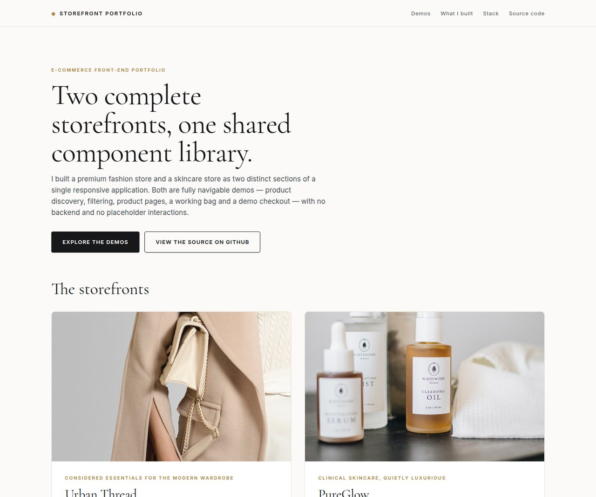
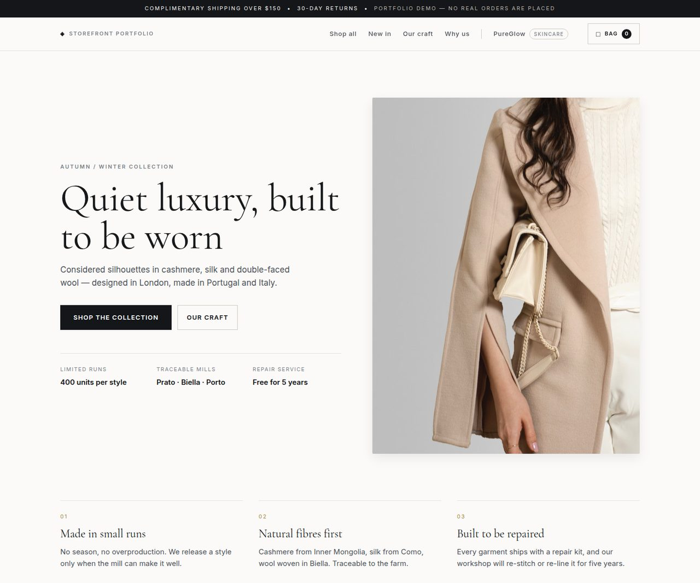
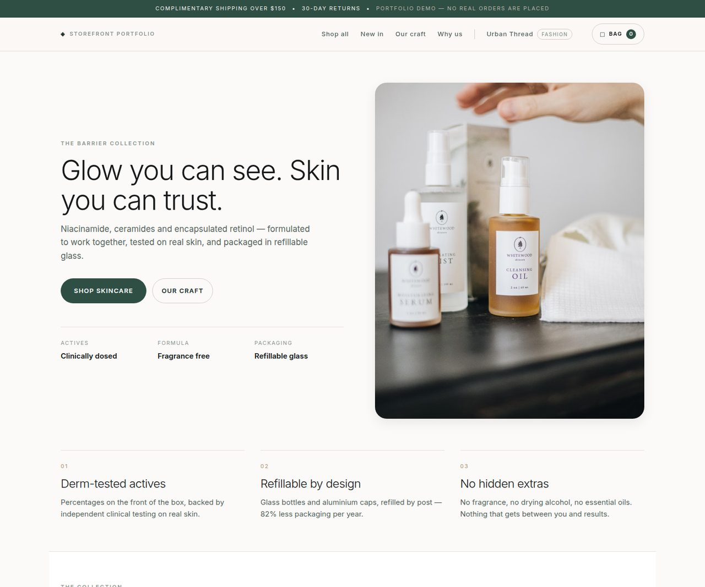

# Storefront Portfolio — Urban Thread & PureGlow

Two complete, responsive e-commerce storefront demos built as one React application with a shared
component library.

| Storefront | Route | What it is |
| --- | --- | --- |
| **Urban Thread** | `/urban-thread` | Editorial fashion store — outerwear, dresses, knitwear, tailoring, essentials, accessories |
| **PureGlow** | `/pureglow` | Clean skincare store — serums, moisturisers, masks, cleansers, oils, SPF |
| Portfolio home | `/` | Landing page introducing both demos, the build and the honest limitations |

**Live demo:** <https://ecommerce-storefront-portfolio.vercel.app/> (also mirrored on GitHub Pages:
<https://vivekshukla04.github.io/ecommerce-storefront-portfolio/>)

| Portfolio home | Urban Thread | PureGlow |
| --- | --- | --- |
|  |  |  |

<sub>Product page and mobile view: [product page](docs/screenshots/urban-thread-product.jpg) · [mobile](docs/screenshots/urban-thread-mobile.jpg)</sub>

> These are portfolio demonstrations. They are not stores I have managed for clients, they have no
> sales history, and the checkout never takes a payment.

---

## Features

Both storefronts are fully wired — no placeholder buttons, no dead links.

- **Product catalogues** — 11 products in Urban Thread, 12 in PureGlow, each with a title, price,
  category, description, materials, care notes, SKU, rating and review count.
- **Live search** — filters titles, categories, descriptions and colourways as you type, with a
  result counter and a one-click clear.
- **Category filters** — chip filters with per-category counts, combinable with the search box.
- **Product detail pages** — large imagery, variant/size pickers, quantity control, spec list,
  shipping and returns details, plus related products.
- **Working bag** — add from a card or a product page, adjust quantity, remove lines, live
  subtotal, free-shipping threshold progress and estimated tax. Cart state persists in
  `localStorage` and is isolated per storefront.
- **Cart drawer** — slide-over panel with the full bag, accessible focus handling, Escape to
  close and a free-shipping nudge.
- **Demo checkout** — validated contact/shipping form, an order summary and a confirmation screen
  with an order reference. No payment provider is integrated and nothing is charged.
- **Resilient imagery** — loading skeletons while images stream in and a branded fallback panel if
  an image fails, so a slow or broken URL never ruins the layout.
- **Responsive design** — fluid grids (4 / 3 / 2 columns), a mobile navigation drawer, sticky
  headers, no horizontal scrolling at 390px, 820px or 1440px.
- **Accessible** — semantic landmarks, one `h1` per view, labelled controls, visible focus rings,
  `aria-pressed` filter states, `aria-live` result and cart counts, a skip link, and
  `prefers-reduced-motion` support.

## Design

Each storefront has its own identity while sharing every component.

- **Urban Thread** — editorial neutral palette, `Cormorant Garamond` display type, square corners,
  uppercase labels and generous whitespace.
- **PureGlow** — porcelain blush and deep botanical green, `Inter` with light weights, rounded
  cards and soft shadows.
- The portfolio home page uses a restrained editorial system that sits between the two.

## Tech stack

- React 19 + React Router 7
- Vite 8 (build tooling)
- Hand-written CSS with custom properties, no UI framework
- `oxlint` for linting
- No backend, no database, no paid services

## Project structure

```
src/
  components/     Shared UI — ProductCard, ProductImage, CartDrawer, SearchBar,
                  CategoryFilter, QuantityStepper, StarRating, EmptyState, Toast,
                  StorefrontLayout
  context/        Cart state (reducer + provider + useCart hook)
  data/           Image URL helper and price formatting
  pages/          PortfolioHome, StorePage, ProductPage, CheckoutPage, NotFound
  stores/         Store configuration and product catalogues
  styles/         base.css (design system), urban.css, glow.css, portfolio.css
scripts/          build-pages.mjs — GitHub Pages build + SPA fallback
```

## Getting started

```bash
npm install
npm run dev      # http://localhost:5173
```

Other scripts:

```bash
npm run build        # production build to dist/
npm run build:pages  # production build for GitHub Pages (base path + 404.html SPA fallback)
npm run preview      # preview the production build
npm run lint         # oxlint
```

## Deployment

**GitHub Pages (live)** — push to `main`; `.github/workflows/deploy.yml` builds with
`npm run build:pages` and publishes `dist/`. The `404.html` fallback keeps deep links such as
`/urban-thread/product/ut-01` working on a static host.

**Vercel (live)** — the production deployment is at
<https://ecommerce-storefront-portfolio.vercel.app>. It is currently deployed from this repository
with the Vercel CLI (`vercel --prod --yes`); the repository is not yet linked to the project, so
pushes do not trigger an automatic Vercel redeploy. Linking it requires installing the Vercel
GitHub App for this repository from the Vercel dashboard.

**Vercel** — `vercel.json` is included: build `npm run build`, output `dist`, with a catch-all
rewrite to `index.html`.

**Netlify** — `netlify.toml` is included (publish `dist`, SPA redirect) and `public/_redirects` is
copied into the build output.

Any static host works: the build output is a plain SPA with hashed assets.

## Testing

Verified with an automated Puppeteer script driving headless Chrome against the production build:
40 interaction and layout checks covering search, category filtering, empty states, product pages,
quantity changes, adding and removing bag lines, bag totals, the checkout flow and confirmation,
cart persistence and per-store isolation, the 404 route, mobile navigation, tablet and mobile
grid breakpoints, horizontal overflow and the image-error fallback. The GitHub Pages build was
additionally tested through a local static server that mimics Pages' 404 fallback behaviour, to
confirm deep links resolve correctly.

## Credits and licensing

- Product photography: [Pexels](https://www.pexels.com/) (free-to-use stock imagery).
- Typefaces: `Cormorant Garamond` and `Inter` via Google Fonts (SIL Open Font License).
- Product names, descriptions, prices and review counts are fictional sample data written for this
  portfolio.

## Limitations

- The checkout is a simulation — no payment provider, no order is created, no email is sent.
- Carts live in browser `localStorage`; clearing site data resets them.
- There is no account, wishlist, review submission, inventory or admin area.
- Product imagery is stock photography rather than original art direction.

## Contact

Built by Vivek Shukla — <https://github.com/VivekShukla04>
